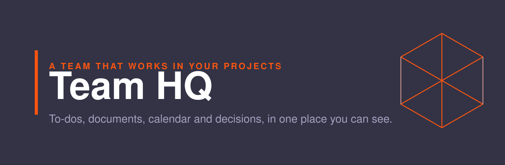
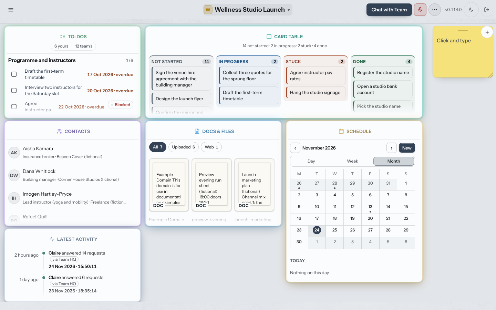
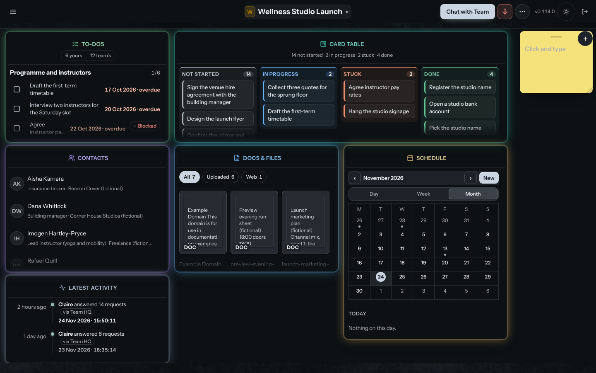
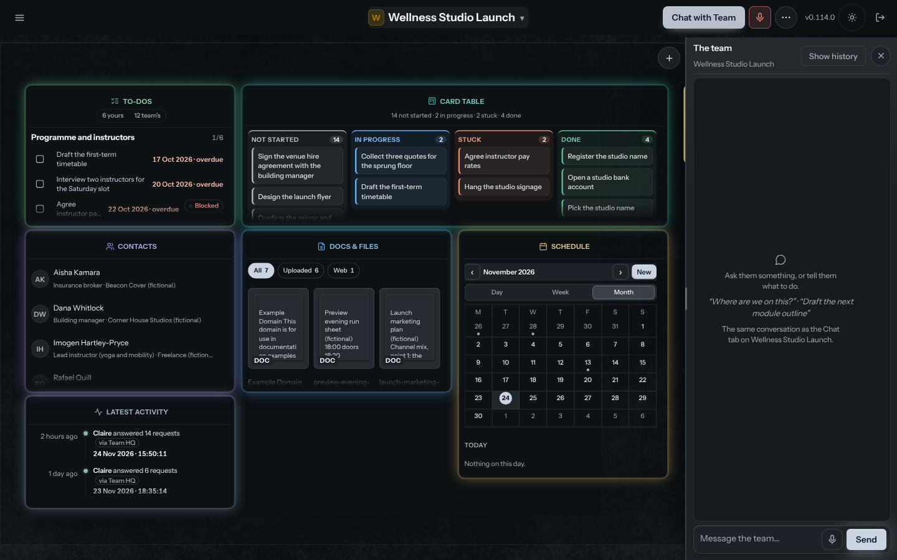
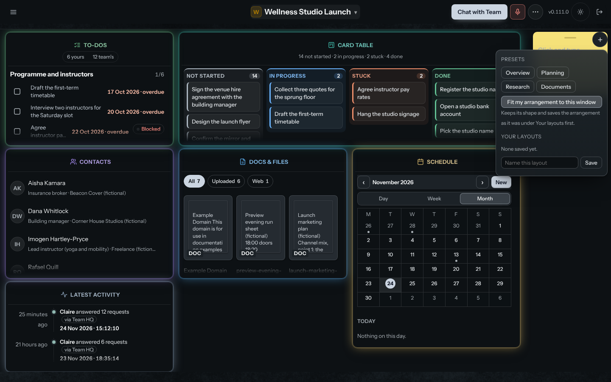
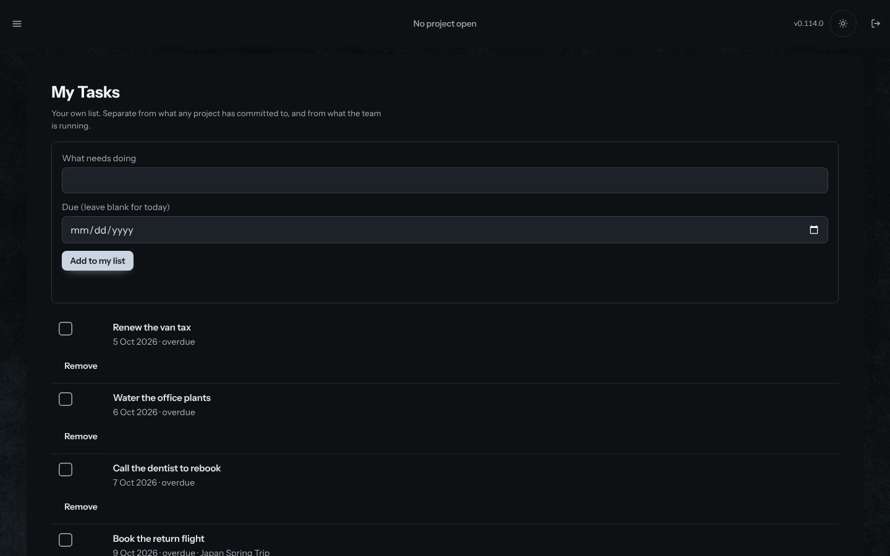
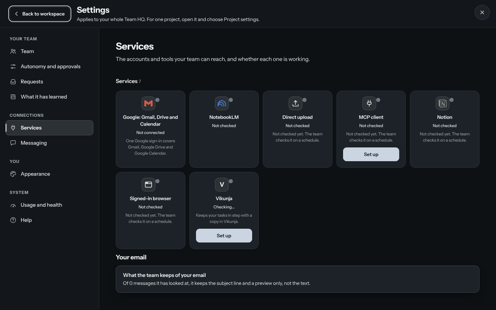
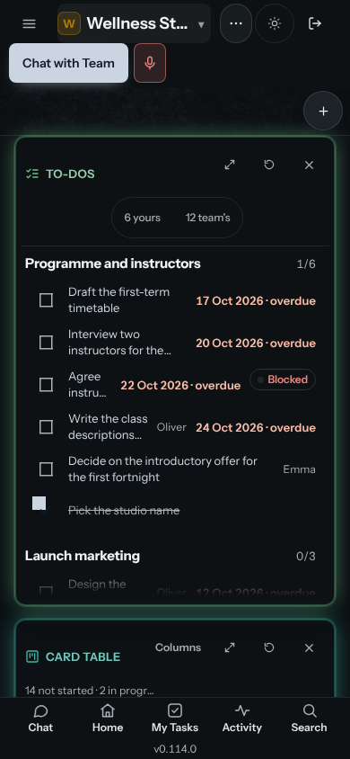
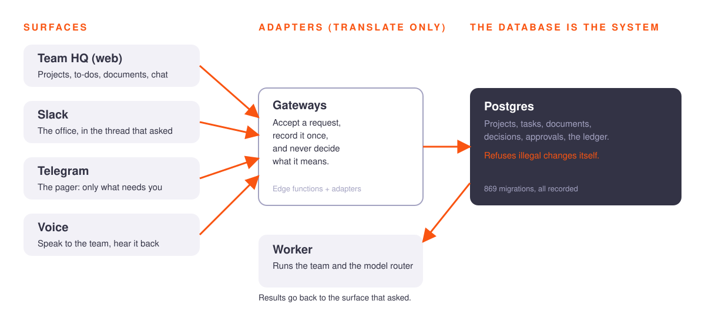

<p align="center">
  
</p>

<h1 align="center">Team HQ</h1>

<p align="center">
  <b>A working team of AI colleagues, built into the projects they work on.</b><br>
  Every to-do, document, contact, decision and calendar entry lives in one place. The team reads it, works from it, asks before it changes anything that matters, and tells you plainly what it did.
</p>

<p align="center">
  <a href="https://ai-team-hq.vercel.app"><b>Open the live app</b></a> ·
  <a href="docs/HANDOFF.md">Start here (for builders)</a> ·
  <a href="docs/known-problems.md">Known problems</a> ·
  <a href="docs/adr/">Decision records</a>
</p>

<p align="center">
  
  
  
  
  
</p>

---

## Why it exists

Work is scattered. The to-do is in one tool, the document in another, the calendar in a third, and the decision you made last month is in a thread nobody can find. A lot of the day goes on carrying information from one place to the next.

Team HQ puts the work in one place and gives it a team:

- **Every project is a single workspace.** To-dos, a Card Table with four states, documents, contacts, the schedule, and the latest activity sit on one board you can arrange.
- **The team is built to answer from your records.** Ask what is overdue, who is blocked, what the documents say, or what to focus on. It reads the project's own tasks and documents. Its answers are still being checked, and the honest status below says where they fall short.
- **It asks before it acts.** Anything that goes outside the office, such as an email to a supplier, is shown as a draft and waits for your yes. Nothing is sent on its own.
- **Decisions queue in one list.** What is waiting for you is counted once, in one place, and matches everywhere it appears.
- **It is honest about what it cannot do.** A booking it cannot make, a payment it cannot send, an account it cannot connect: it says so, and tells you where you do it yourself.

The efficiency case is simple. Less time moving information between tools, fewer questions that need someone to go and look, and a team that carries the routine follow-up while you decide the things that need you.

---

## See it

<table>
  <tr>
    <td width="50%"><br><sub><b>A project on one board.</b> To-dos with overdue dates, a Card Table in four states, contacts, documents and the schedule.</sub></td>
    <td width="50%"><br><sub><b>Light and dark, both designed.</b> Every state has a word as well as a colour.</sub></td>
  </tr>
  <tr>
    <td width="50%"><br><sub><b>Chat with the team, beside the work.</b> Ask about the project you are looking at; the answer appears in the thread.</sub></td>
    <td width="50%"><br><sub><b>Arrange it your way.</b> Presets, saved layouts, Tidy, Reset view and Fit, from one button.</sub></td>
  </tr>
  <tr>
    <td width="50%"><br><sub><b>Your own list.</b> My Tasks gathers your to-dos across every project, with due dates and what is overdue.</sub></td>
    <td width="50%"><br><sub><b>Every connection, in one place.</b> Services shows what the team can reach and whether each one is working.</sub></td>
  </tr>
  <tr>
    <td colspan="2" align="center"><br><sub><b>Built for the phone too.</b> The same board, with bottom navigation, at 390 pixels wide.</sub></td>
  </tr>
</table>

> The screenshots show the **Sample Office**, which holds fictional test data. Nothing in them is a real person's or a real company's.

---

## What is in it

| | |
|---|---|
| **Projects** | A workspace per project: to-dos, a Card Table with four states you can rename or hide, documents and files, contacts, a schedule and the latest activity. |
| **The team** | A chief of staff and specialist colleagues, each with a remit and a communication style. They answer in the thread that asked and show who answered. |
| **Chat** | One conversation per project, with history. Answers are released only once the team has the facts it needs. |
| **My Tasks** | Your own list across every project: due dates, overdue items, and what is coming up. |
| **Decisions and approvals** | Anything that needs your yes is in one list, counted once, shown the same everywhere. |
| **Arrangement** | Drag, resize, Tidy, Reset view, Fit, presets and named layouts. A saved layout can be brought back from the Layouts menu. |
| **Connections** | Services shows Google (Gmail, Drive and Calendar), Notion, Vikunja, MCP clients, the signed-in browser and direct upload, each with its status. |
| **Messaging** | Slack and Telegram adapters. They translate messages in and out; they do not decide anything. |
| **Voice** | Speak to the team and hear answers back. Degrades to text when no voice credential is set. |
| **Undo and audit** | Changes are recorded in a ledger. Undo and the record of who did what are part of the design, not an afterthought. |

---

## How it fits together



**The database is the system.** Projects, tasks, documents, decisions, approvals and the ledger live in Postgres. The surfaces, the gateways and the worker are all replaceable parts that read from and write to it. The database refuses changes that break the rules, rather than trusting each caller to check.

Three rules hold the design together:

1. **Adapters translate and never decide.** A Slack or Telegram message becomes a command. What that command means is decided in one place.
2. **Replies are released only inside the answer format.** A reply is shown only when it is wrapped in the answer format the router checks for. Working-out outside it is discarded, not shown.
3. **Anything that changes the outside world waits for a person.** Sending, paying, booking and connecting accounts are never done silently.

---

## Measured, not claimed

These numbers come from the repository itself at version 0.115.0.

| What | Count |
|---|---|
| TypeScript source files in `src/` | 317 (about 97,000 lines) |
| Browser modules in `web/studio/` | 79 (about 51,000 lines), no build step |
| Database migrations, all recorded in the ledger | 869 |
| Test files | 511 |
| Unit tests passing | 7,687 (21 skipped) |
| Decision records in `docs/adr/` | 84 |
| npm scripts (checks, verifications, deploys) | 528 |

`npm run verify` runs the core gate: lint, typecheck, the migration ledger, the full unit suite and a secret scan.

---

## Honest status

Team HQ is in active use and improving quickly. It is not finished, and the known problems are written down rather than hidden.

| Area | State |
|---|---|
| Projects, to-dos, Card Table, documents, contacts, schedule | Working |
| Chat with the team, per project | Working; answer accuracy is the main open problem |
| Asking before sending | Checked: a draft is shown and waits for your yes |
| Refusing what it cannot do (bookings, payments, account connections) | Being tested in the co-work suite; not yet confirmed |
| Arrangement, presets, Tidy, Fit | Working; a narrow window keeps a legibility floor, so some modules scroll |
| Answers about overdue or blocked work | **Known problem.** The team has, in testing, sometimes said nothing is overdue or blocked when the records show otherwise. Tracked in [`docs/known-problems.md`](docs/known-problems.md) |
| Voice | Built; text fallback |
| Google, Notion, Slack, Telegram connections | Available per office; each one shows its own status in Services |

If you find a case where the team's answer does not match the project, that is exactly the kind of report that moves this forward.

---

## Run it

You need Node 22 or newer and a Supabase project for your own data.

```bash
git clone https://github.com/granterogers/agentic.team.grant
cd agentic.team.grant
npm ci

npm test            # the unit suite (7,687 tests)
npm run verify      # lint, typecheck, migration ledger, tests, secret scan
```

The studio is plain files in `web/studio/` with no build step. Serve that folder with any static server. Signing in and the data need a Supabase project; see [`docs/new-environment.md`](docs/new-environment.md) for the variables and the first commands.

Deploys and production checks are behind explicit flags, so a command cannot touch production by accident. The rules are in [`docs/production-access-guard.md`](docs/production-access-guard.md).

---

## Read more

| If you want to | Read |
|---|---|
| Understand the design | [`docs/architecture.md`](docs/architecture.md) and [`AI_TEAM_HQ_MASTER_SPEC.md`](AI_TEAM_HQ_MASTER_SPEC.md) |
| See the decisions and why they were made | [`docs/adr/`](docs/adr/) (84 records) |
| See what is wrong right now | [`docs/known-problems.md`](docs/known-problems.md) |
| See what the checks caught | [`docs/defects-fixed.md`](docs/defects-fixed.md) and [`docs/test-evidence/`](docs/test-evidence/) |
| Start a working session | [`docs/HANDOFF.md`](docs/HANDOFF.md) |
| Find your way around everything else | [`docs/README.md`](docs/README.md) |

---

## Licence

No licence has been chosen yet. Until one is added, all rights are reserved by the author. Ask before reusing the code.
